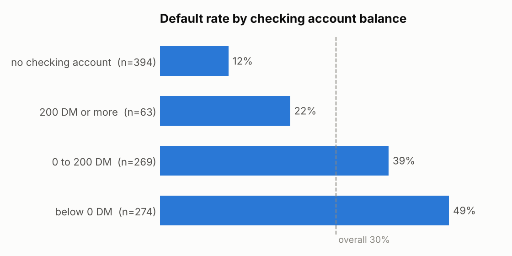
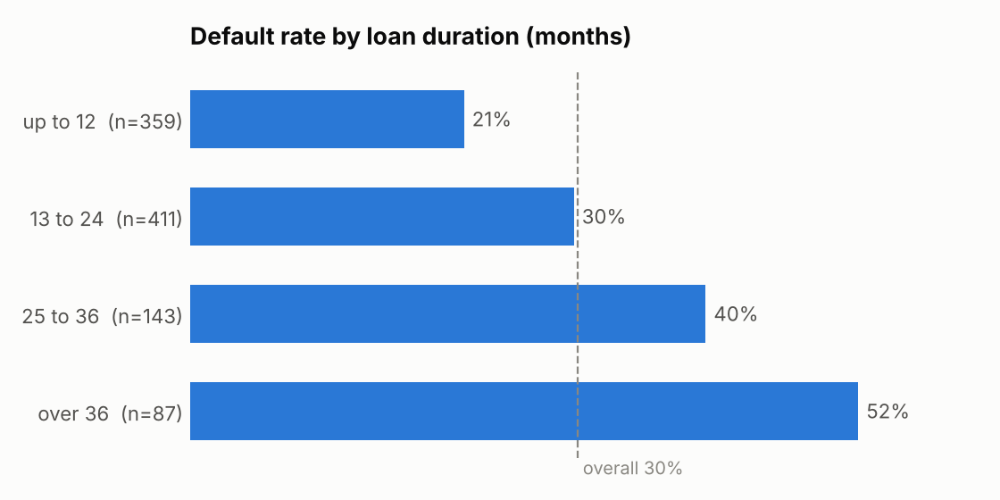
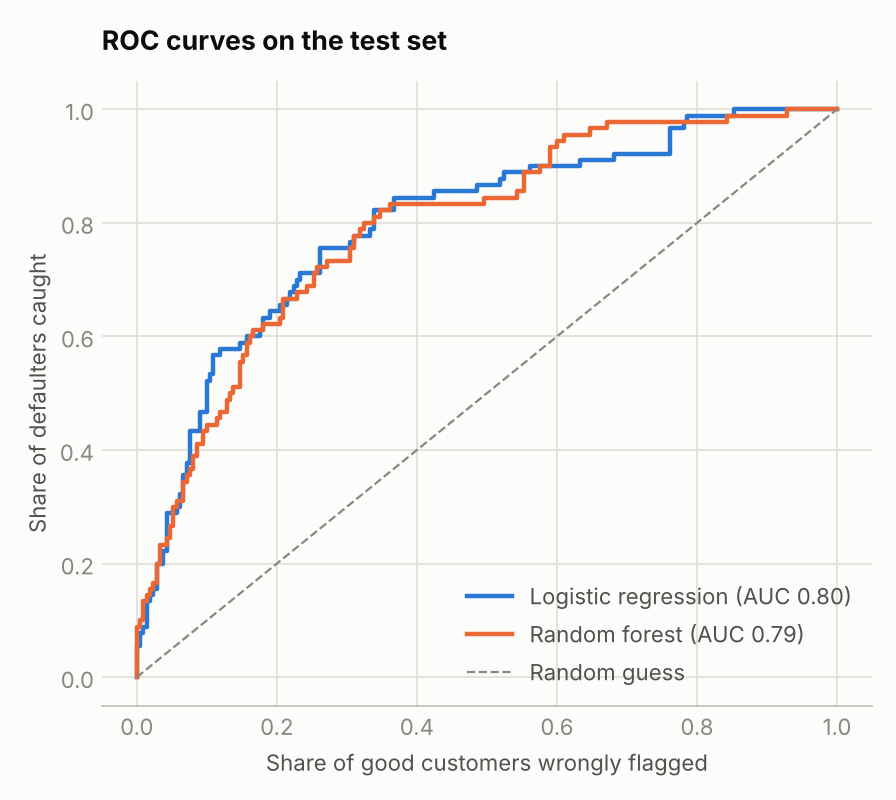
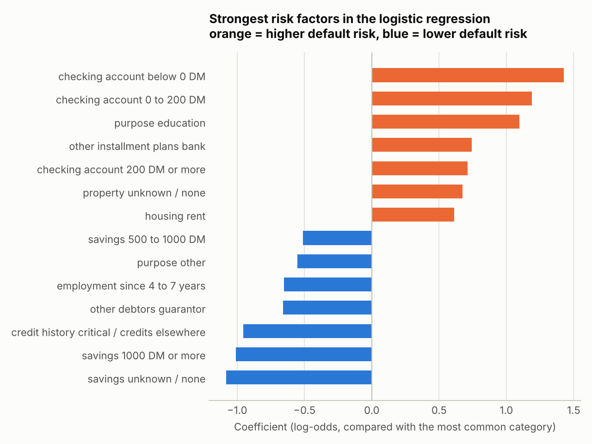
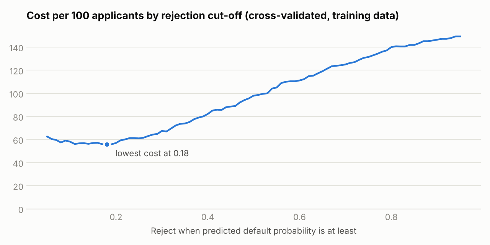

# Credit Risk Analysis: German Credit Data

Which loan applicants are likely to default, and where should a lender draw the line between approving and rejecting? This project answers both questions on a real public dataset, using Python and scikit-learn.

**Main results**

- A logistic regression model separates good from bad borrowers with an **AUC of 0.80 (Gini 0.60)** on unseen test data.
- The checking account is the strongest single signal: **49 % of applicants with an overdrawn account defaulted**, against 12 % of those without a checking account at this bank.
- Because a bad loan costs five times as much as a rejected good customer, the cheapest policy is to reject at a predicted default probability of only **0.18**. That cuts the cost of wrong decisions by **64 %** compared with approving everyone, and by a third compared with the usual 0.50 cut-off.

## Data

[Statlog (German Credit Data)](https://archive.ics.uci.edu/dataset/144/statlog+german+credit+data) from the UCI Machine Learning Repository, donated by Prof. Hans Hofmann, University of Hamburg (licence: CC BY 4.0).

- 1,000 loans, each labelled as a good (700) or bad (300) credit risk
- 20 applicant attributes: checking account, savings, credit history, loan purpose, amount and duration, employment, housing, age and others
- Amounts are in Deutsche Mark; the data dates from before 1994
- A cost matrix supplied with the data: approving a bad loan costs 5, rejecting a good customer costs 1

The raw file `german.data` stores categories as codes such as `A11`. The script translates them into readable labels.

## Method

1. **Explore:** default rate for each category of the main attributes
2. **Model:** logistic regression (the standard scorecard method in credit risk, because every coefficient can be explained) compared with a random forest
3. **Validate:** 70/30 train/test split, stratified by outcome, plus 5-fold cross-validation on the training data
4. **Decide:** choose the rejection cut-off that minimises the cost of wrong decisions, using cross-validated predictions on the training data only, then check it on the test set

Sex/marital status and foreign-worker status are deliberately left out of the model. A lender should not base a credit decision on them.

## Findings

### 1. Who defaults?

Overall, 30 % of the loans in the data are bad.





| Attribute | Lowest default rate | Highest default rate |
|-----------|--------------------|----------------------|
| Checking account | no account here: 12 % | overdrawn: 49 % |
| Loan duration | up to 12 months: 21 % | over 36 months: 52 % |
| Savings | 1,000 DM or more: 13 % | below 100 DM: 36 % |
| Loan amount | third quarter: 22 % | highest quarter: 42 % |
| Age | 35 to 49: 23 % | under 25: 41 % |
| Housing | owner: 26 % | rent-free: 41 %, renting: 39 % |

The full table is in `default_rates.csv`.

### 2. How well can default be predicted?

| Model | Cross-validated AUC | Test AUC | Test Gini |
|-------|--------------------|----------|-----------|
| Logistic regression | 0.76 (± 0.02) | 0.80 | 0.60 |
| Random forest | 0.79 (± 0.03) | 0.79 | 0.59 |



The two models perform about the same; the differences are within the spread of the cross-validation folds. I use the logistic regression for the decision step because it is easier to explain.

### 3. What drives the model?



Coefficients compare each category with the most common one for that attribute. For example, an applicant with an overdrawn checking account has about 4 times the odds of default of an applicant with no checking account, all else equal. Savings, a guarantor and stable employment lower the risk. All coefficients are in `odds_ratios.csv`.

### 4. Where should the cut-off be?



Results on the 300 test loans (90 bad, 210 good):

| Policy | Applicants rejected | Bad loans approved | Good customers rejected | Cost per 100 applicants |
|--------|--------------------|--------------------|-------------------------|-------------------------|
| Approve everyone | 0 % | 90 | 0 | 150.0 |
| Model, cut-off 0.50 | 22 % | 45 | 21 | 82.0 |
| **Model, cost-based cut-off 0.18** | **61 %** | **12** | **104** | **54.7** |
| Reject everyone | 100 % | 0 | 210 | 70.0 |

The cost-based cut-off of 0.18 is close to the theoretical value of 1/6 ≈ 0.17 that follows from a 5:1 cost ratio. It catches 78 of the 90 bad loans, but at a price: 61 % of applicants are turned away, including half of the good customers. With costs this lopsided, even rejecting everyone is cheaper than the default 0.50 cut-off. Whether a real lender would accept that depends on how much profit a good loan brings, which this dataset does not say.

## Limitations

- **Small and old.** 1,000 loans from before 1994, in a currency that no longer exists. The patterns are illustrative; a model for today would need current data.
- **Not a real portfolio.** A 30 % share of bad loans is far above what a lender would see, and the data only covers applicants who were granted a loan, so nothing is known about those who were rejected.
- **Credit history looks odd.** Applicants labelled "critical account" default least (17 %), and those with "no credits / all paid back" default most (63 %). The labels probably do not mean what they suggest, so I would not interpret this attribute without knowing how the bank coded it.
- **Test set of 300.** AUC values on so few loans can move by a few points with a different split, which is why the cross-validation figures are reported alongside.
- **Fairness.** Age is still in the model and is related to default here. A production model would need a proper review of which attributes may be used.

## Files

| File | Content |
|------|---------|
| `credit_risk_analysis.py` | the whole analysis, from raw file to charts |
| `german.data` | the raw dataset |
| `default_rates.csv` | default rate per attribute and category |
| `model_comparison.csv` | AUC and Gini of both models |
| `odds_ratios.csv` | logistic regression coefficients and odds ratios |
| `decision_policies.csv` | cost of each approval policy on the test set |
| `*.png` | charts |

## How to run it

Requires Python 3.9 or newer.

```bash
pip install -r requirements.txt
python credit_risk_analysis.py
```

**Tools:** Python, pandas, scikit-learn, Matplotlib
